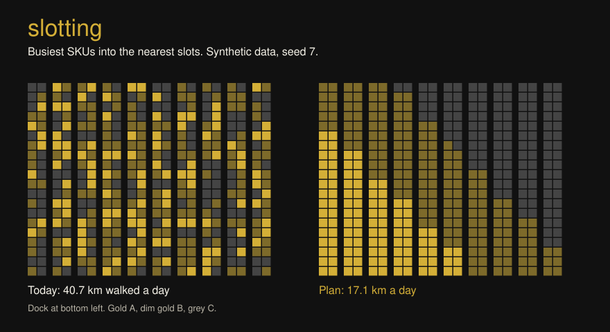
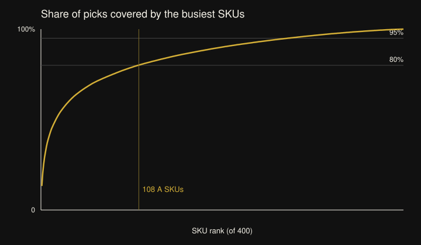
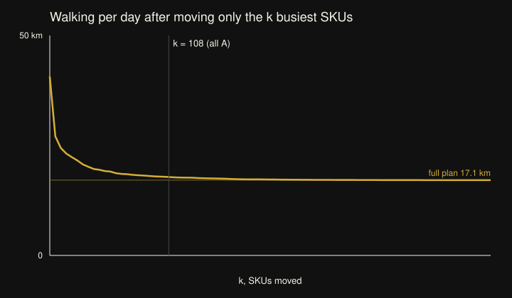

<p align="center">
  
</p>

<p align="center"><em>Synthetic data: 400 invented SKUs, 20 days of orders, seed 7. Wage and walking speed are illustrative.</em></p>

Finds where each SKU should sit in a pick area so pickers walk less. DuckDB SQL ranks SKUs
by how often they are picked and splits them into A, B and C; a TypeScript library places
the busiest ones nearest the dock and prices the walking saved; a browser slot map lets a
team lead drag items around and watch the kilometres and the cost change.

```bash
npm ci && npm run build
npm run demo                          # 40.68 km/day today, 17.12 km/day planned
npm test                              # 100% coverage required
```

## Problem

Items usually go wherever a slot is free on the day they arrive. A year later the fastest
movers are spread across the whole area and pickers cross it all day for them. Moving every
item is a weekend of work, so the useful questions are how much walking a full re-slot saves,
and how much of that comes from moving only the few items that matter.

## Method

1. **ABC in SQL** (`sql/abc.sql`): lines per SKU, a running share with a window function,
   and the class. A SKU is A while the share of picks before it is under 80%, B under 95%,
   C after. Each line counts as one trip, whatever the quantity.
2. **Layout** (`src/layout.ts`): 10 aisles of 20 bays with a slot each side, off a front
   cross aisle. The walk to a slot is along the cross aisle and then down the aisle to the
   middle of the bay.
3. **Plan** (`src/plan.ts`): the i-th busiest SKU goes to the i-th nearest slot. With one
   round trip per line, walking is the sum of picks x 2 x distance, and pairing large picks
   with small distances minimises that sum (the rearrangement inequality). A second option
   moves only the A items into the nearest slots and counts the physical moves.
4. **Cost** (`src/cost.ts`): hours at 0.8 m/s and an illustrative 25.00 BRL per picker hour,
   kept as whole centavos in `bigint` and rounded half up once.
5. **Slot map** (`src/editor.ts`, `web/`): the plan as a grid coloured by class. Drag or
   click to swap two slots; the walking per day and its cost update at once. Buttons switch
   between today, A only and the full plan.

Derivation and hand-checked cases: [docs/derivation.md](docs/derivation.md).

## How to run

```bash
npm ci
npm run typecheck && npm run lint && npm run format && npm test
npm run build
node dist/src/cli.js demo --seed 7 --write out        # lines.csv, current.csv, plan.csv
node dist/src/cli.js plan out/lines.csv --current out/current.csv --out plan.csv
node dist/src/cli.js demo --json web/public/data.json && npm run web   # slot map in the browser
npm run figures                                        # docs/img/*.svg
```

Own data: a CSV of order lines with `day,order,sku,qty`, read by DuckDB's `read_csv`
(`examples/lines.csv` shows the format). Add `--current` with a `sku,slot` CSV to compare
against today's map; slot ids look like `03-12-L` (aisle, bay, side). `--aisles`, `--bays`,
`--a` and `--b` change the grid and the ABC cuts.

## Result

Default run, seed 7: 14,352 lines over 20 days, 400 SKUs split 108 A, 165 B, 127 C.

| Map                        |          Walking | Picker time |           Cost | SKUs moved |
| -------------------------- | ---------------: | ----------: | -------------: | ---------: |
| Today (slotted by arrival) |     40.68 km/day |     14.12 h |     353.10 BRL |            |
| Move only the 108 A items  |     17.83 km/day |      6.19 h |     154.75 BRL |        187 |
| Full plan                  | **17.12 km/day** |  **5.94 h** | **148.61 BRL** |        400 |

Moving only the A items gets 97% of the full plan's saving. The 187 moves are the 108 A
items plus the items they push out of the nearest slots. Across seeds 1 to 10 the full plan
cut walking by 46% to 59%, and the A-only move needed 179 to 198 moves.


_Synthetic demand that falls off as 1/rank. 108 of 400 SKUs carry 80% of the picks._


_Seed 7. Almost all of the saving comes from the first few dozen items; past the A items the
curve is flat._

## Limits

- Data is synthetic: invented SKUs, a Zipf demand curve and a random starting map. Wage and
  speed are illustrative. Real demand is less tidy and shifts by season, so re-run the query
  on recent lines before moving anything.
- Every line is costed as its own round trip from the dock. Real pickers batch several lines
  per trip, which shrinks the saving. A tour model, such as the one in my `pick-path` repo,
  would be the next step.
- Slots are all the same size and every SKU fits anywhere. No weight rules (heavy low), no
  golden zone by height, no family grouping, no replenishment cost.
- The plan ignores the labour of moving items. The A-only option and the moves column are
  there so that cost can be weighed by hand.
- Technology choices: SQL for the ABC because it is a group-by and a window, and DuckDB runs
  it in process on a CSV with no server; TypeScript so the same scoring code runs in the CLI
  and in the browser map; `bigint` centavos so money has no float error. The web page is a
  thin entry file that is not unit tested; all the logic it calls is.
- README principle: beauty that arises from utility. The slot map is the argument, and it is
  also the tool a team lead uses to try a change before moving a pallet.
